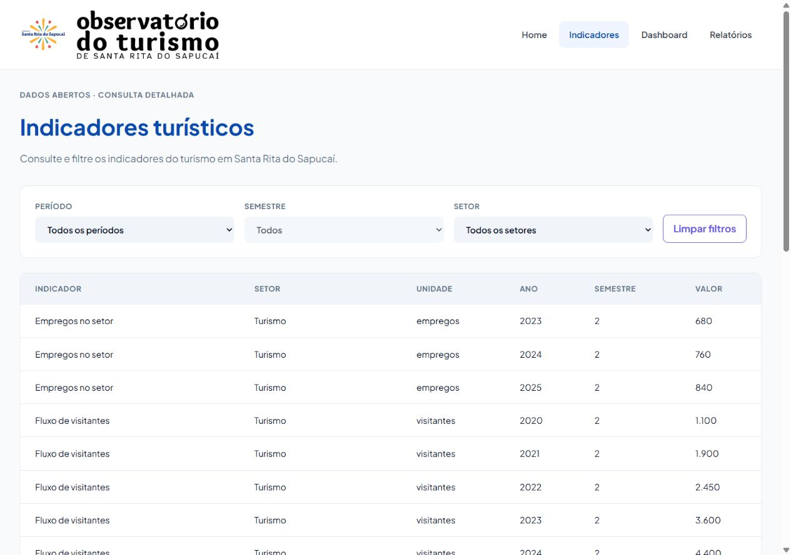
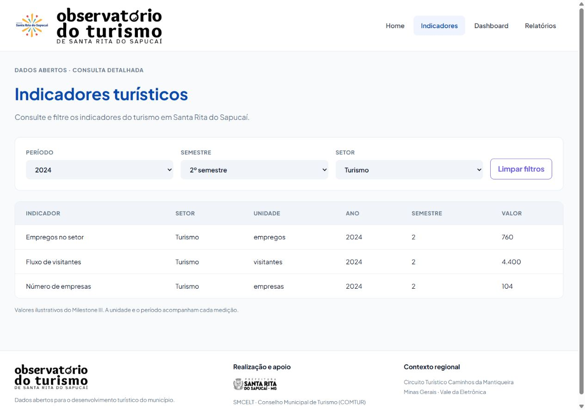
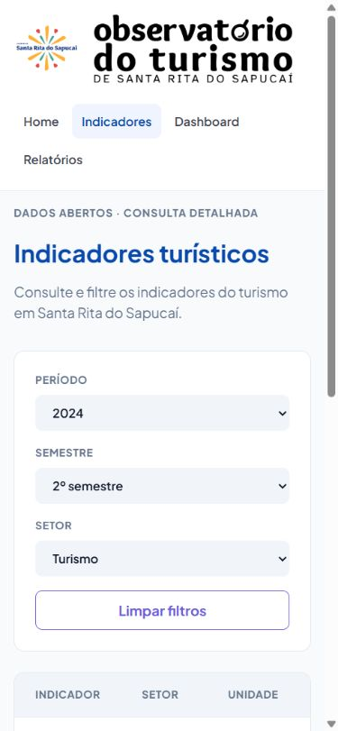
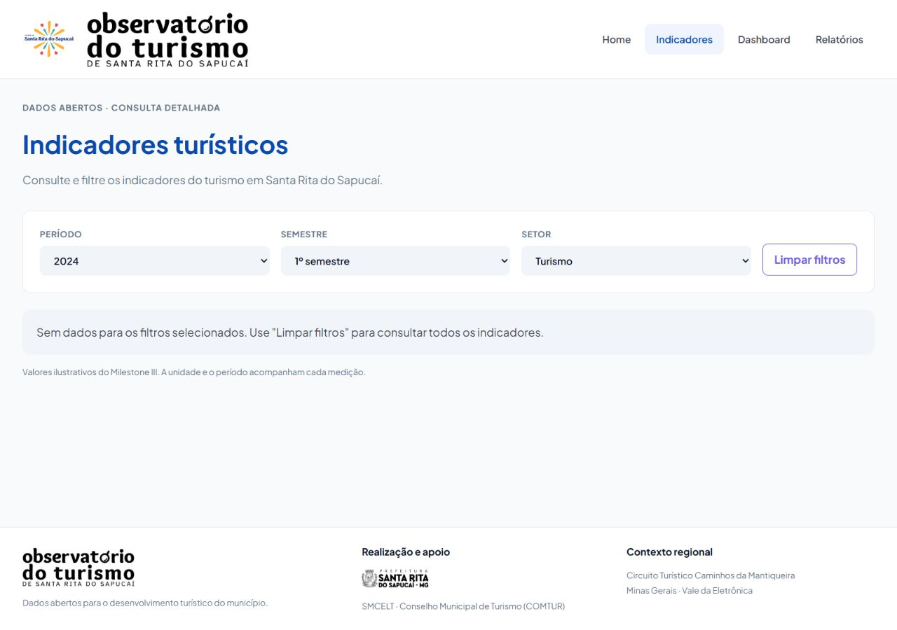

# Evidências da #111 — Indicadores turísticos

Referência: [Tela 3 — Indicadores Turísticos no Stitch](https://stitch.withgoogle.com/projects/10242954063342123145), tela `79d21d51db2345819278ce03692cd5c8`.

A página reutiliza o `FiltrosPainel` aprovado no #119 e mantém as colunas de
unidade, ano, semestre e valor do M4, acrescentando Setor após Indicador.
O subtítulo segue a Tela 3. Pesquisa e coluna Variação ficam fora desta entrega.

## Validação

- `npm test`: 116 testes passando em 14 arquivos.
- `npm run lint`: sem avisos.
- `npm run build`: aprovado; permanece o aviso de tamanho do pacote do Recharts.
- Navegador com `VITE_USE_MOCK=true`: 23 medições ao abrir sem filtro; três
  medições em Turismo/2024/2, com filtros preservados após recarregar.
- Sem resultado em Turismo/2024/1; “Limpar filtros” retorna às 23 medições.
- Sem erros ou avisos no console durante essa conferência.
- Desktop de 1280 × 900 e celular de 390 × 844. Também conferida a largura de
  320 px: o painel não transborda e a tabela permite rolagem horizontal interna.
- Docker Compose não foi executado localmente porque o Docker Desktop estava
  indisponível. A validação do sistema completo fica com o CI e a integração #76.

## Capturas

Sem filtro: `/indicadores`, com todos os setores.

Depois de recarregar `/indicadores?ano=2024&semestre=2&setor=2`.
Semestre e setor também foram selecionados pelo teclado.

O mesmo filtro no celular, com a rolagem horizontal restrita à tabela.

Sem dados em `/indicadores?ano=2024&semestre=1&setor=2`, com o botão de limpeza disponível.

