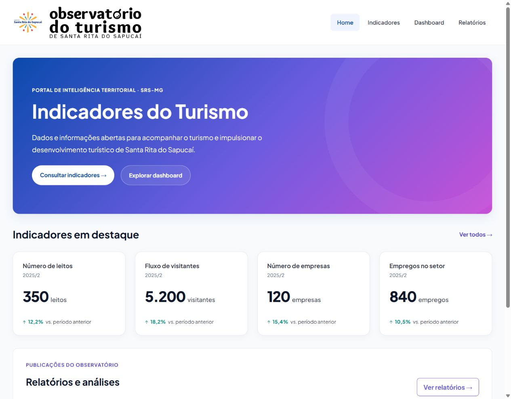
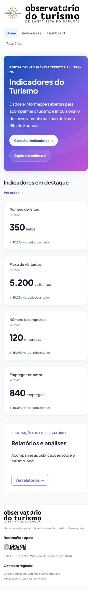

# Evidências da #112 — Destaques da Home

Referência: [Tela 1 — Página Inicial no Stitch](https://stitch.withgoogle.com/projects/10242954063342123145), tela `9d981381c2f24f1a946b8d76509be510`.

A Home seleciona somente Número de leitos, Fluxo de visitantes, Número de empresas
e Empregos no setor, nessa ordem, seguindo os cards principais do dashboard.
Os nomes e os valores continuam vindo do contrato da API. O texto do banner
passa a falar de turismo, conforme o comentário do Christian na #112.

## Validação

- `npm test`: 110 testes passando em 14 arquivos, na branch baseada na `develop`,
  independente do PR #133 (#111), ainda em revisão.
- `npm run lint`: sem avisos.
- `npm run build`: aprovado; permanece o aviso conhecido de tamanho do pacote.
- Testes com a carga completa e com resposta embaralhada: quatro destaques,
  na ordem prevista, sem participação econômica nem outros indicadores.
- Resposta parcial: somente os destaques disponíveis são exibidos. Uma resposta
  sem os indicadores previstos usa o estado existente de ausência de dados.
- Navegador com `VITE_USE_MOCK=true`: leitos 350, visitantes 5.200, empresas 120
  e empregos 840, preservando período, unidade e variação dos cards existentes.
- Conferidos desktop de 1280 × 1000 e celular de 390 × 844 e 320 × 844,
  sem rolagem horizontal da página nem avisos ou erros no console.
- Nenhuma mudança no dashboard, na API, nos mocks ou no CSS compartilhado.

## Capturas

