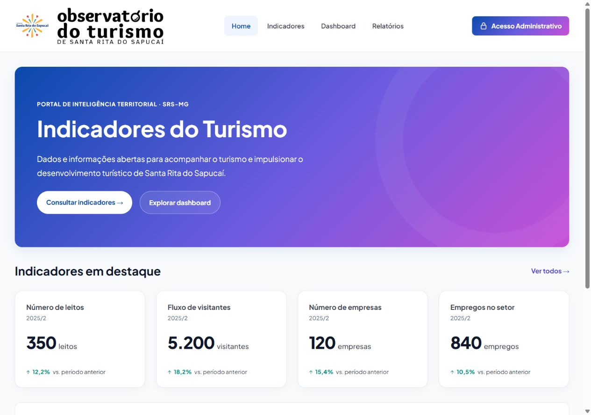
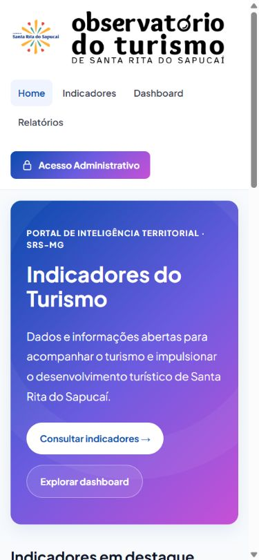
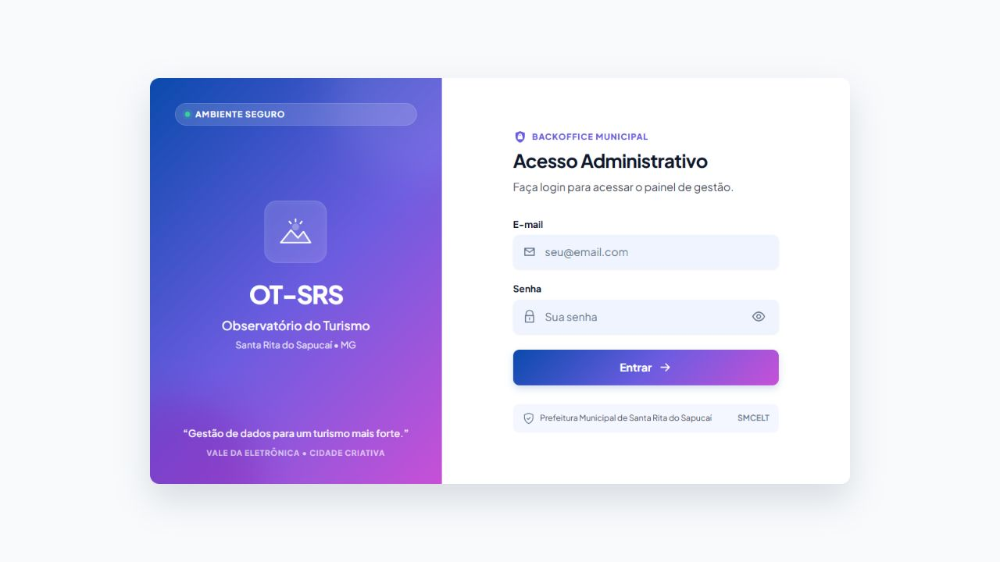

# Evidências da #113 — Acesso Administrativo

O cabeçalho das páginas públicas oferece o link “Acesso Administrativo” para
`/admin/login`, reutilizando o botão principal do tema. O cadeado é decorativo;
o nome acessível é o próprio texto do link.

Referência: [cabeçalho do protótipo no Stitch](https://stitch.withgoogle.com/projects/10242954063342123145), tela `40dcbf6d24284f80b700ff2638ca6e05`.
O protótipo usa gradiente e cadeado. O destino foi adaptado à rota definida na
#113 e à tela de login já entregue no projeto. O acesso permanece visível no
celular; o cabeçalho pode quebrar linha para acomodar o novo link.

## Validação

- Testes de navegação e login: 14 passando com `npm test -- src/__tests__/App.test.jsx src/__tests__/AdminLoginPage.test.jsx`.
- Cinco casos adicionados: link nas quatro páginas públicas e navegação para
  o formulário de login existente, sem enviar credenciais.
- `npm run lint`: sem avisos. `npm run build`: aprovado, com o aviso já conhecido
  sobre tamanho do pacote.
- Suíte completa: 167 testes passaram e três testes de filtros do Dashboard
  falharam. São os mesmos três casos já falhando no [CI da develop antes desta alteração](https://github.com/Christiansalles/ot-srs-platform/actions/runs/38923113394).
  Nenhum arquivo do Dashboard foi alterado nesta tarefa.
- Conferência no navegador com `VITE_USE_MOCK=true`: link visível em 320, 390,
  768 e 1280 px, sem transbordamento horizontal. A tecla Enter abre o login.
  Nenhum aviso ou erro no console durante essa conferência.
- Autenticação, proteção de rota e encerramento de sessão continuam nas entregas
  da Maria Clara; esta tarefa adiciona somente o acesso pelo cabeçalho.

## Capturas

Tela existente aberta pelo link, sem alteração no formulário:

