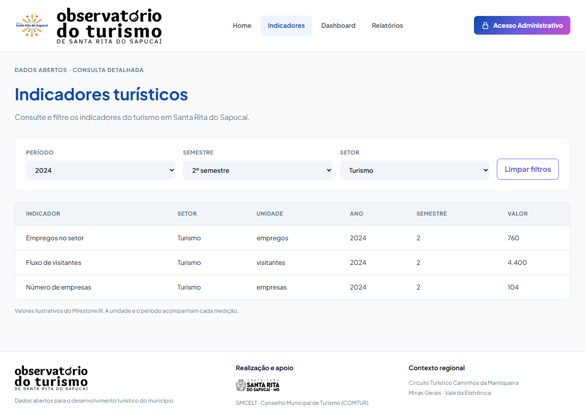
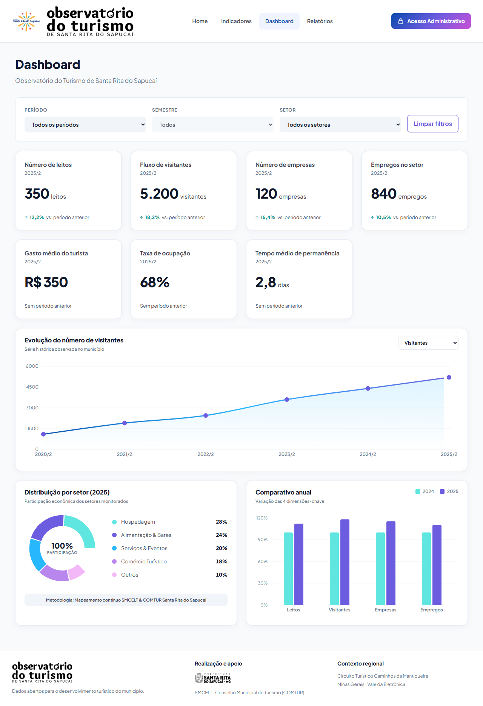
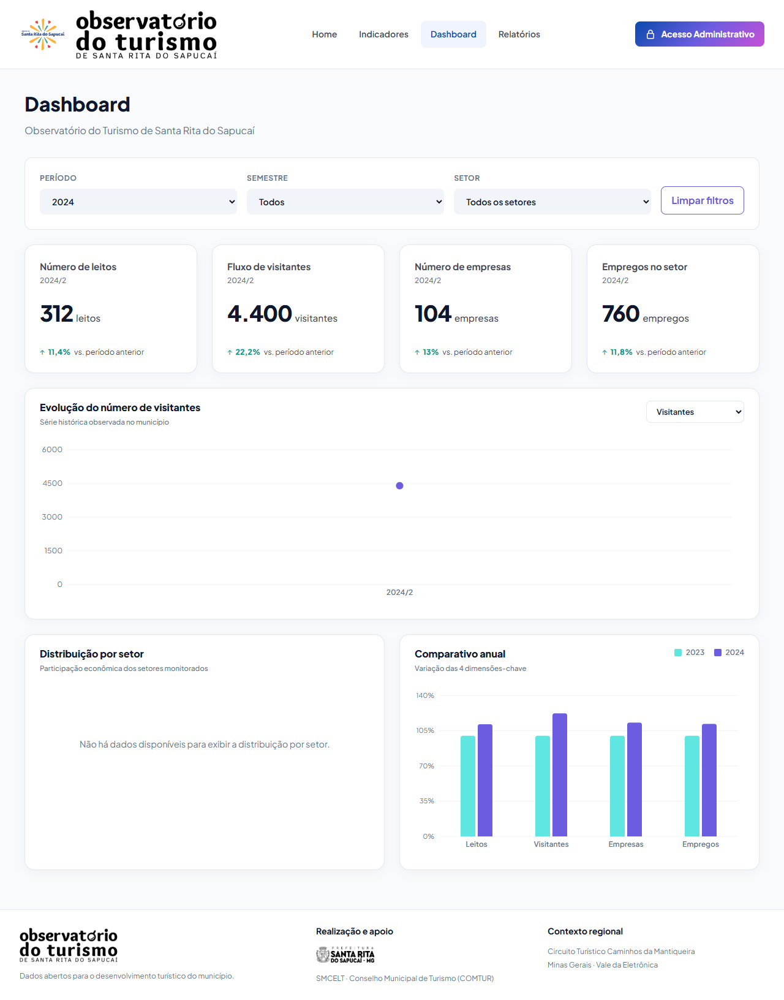
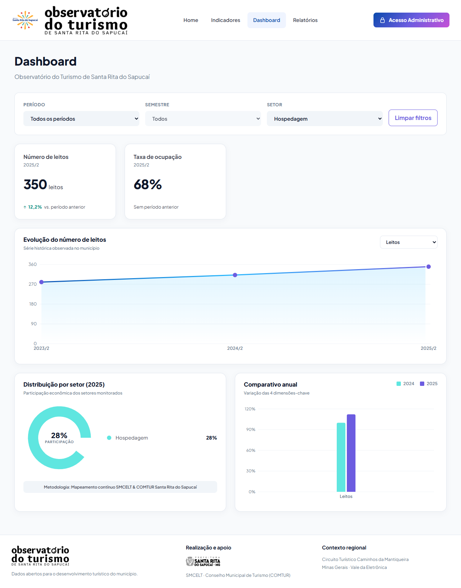
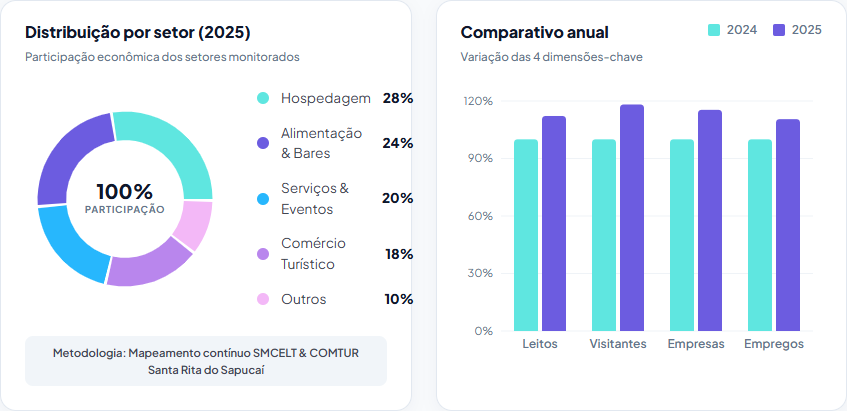
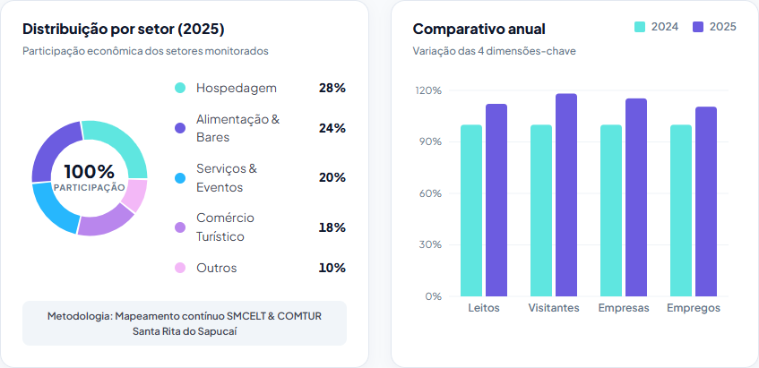
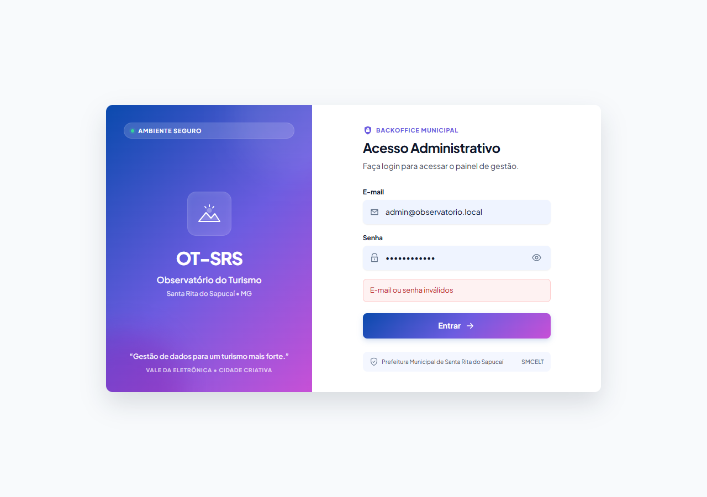
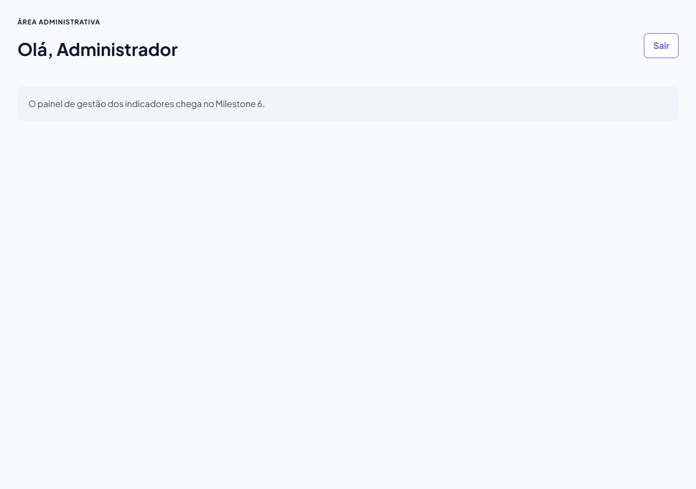

# Evidências da #76: integração com a API real

Stack completa com `docker compose up --build`: o front em `http://localhost:8080`
(build sem `VITE_USE_MOCK`, ou seja, API real) consulta a API em
`http://localhost:3000`, que sobe com migrate e seed da carga do M5
(6 setores, 12 indicadores, 23 medições). Capturas a 1280 px, exceto as da rosca.

## O que foi conferido

**API**, contra os valores esperados em `Milestone5_Tarefas/01_Christian.md`:

- `destaques` sem filtro: leitos 350 (`12.2`), visitantes 5.200 (`18.2`),
  empresas 120 (`15.4`), empregos 840 (`10.5`).
- `destaques?ano=2024`: leitos 312 (`11.4`), visitantes 4.400 (`22.2`),
  empresas 104 (`13`), empregos 760 (`11.8`). Ocupação e os indicadores de uma
  medição só ficam de fora.
- `?ano=abc`, `?ano=25`, `?semestre=3&ano=2024`, `?semestre=2` e `?setor=abc`
  devolvem `400` com `{ "erro": ... }`; `?ano=2019` devolve `200` com `[]`.
- Login: senha errada dá `401` com "E-mail ou senha inválidos"; a senha certa
  devolve o token e o usuário sem `senha_hash`; `/api/auth/me` responde `200`
  com o token e `401` sem ele ou com um token inválido.
- CORS: o preflight vindo de `:8080` libera `authorization` (o front envia o
  token em toda chamada depois do login) e `content-type` (login).

**Telas**, no navegador, com a API real:

- Indicadores: 23 medições sem filtro; `?ano=2024&semestre=2&setor=6` mostra as
  3 medições de Turismo e se mantém ao recarregar; 2024/1 mostra o estado sem
  dados; "Limpar filtros" volta às 23.
- Dashboard: cards, série histórica, rosca (28/24/20/18/10, na paleta) e
  comparativo anual (2024 × 2025) sem filtro. Com `?ano=2024` os cards mostram
  2024/2 e o comparativo passa a 2023 × 2024. Com `?setor=1` aparecem só os
  dados de Hospedagem. Com `?ano=2024&semestre=1` aparece o estado vazio.
- Home: os mesmos quatro destaques do M4.
- Login: `/admin` sem sessão redireciona para `/admin/login`; senha errada
  mostra o erro; a certa abre `/admin`; recarregar valida a sessão no `/me`;
  `/admin/login` com sessão volta para `/admin`; token inválido derruba a sessão;
  "Sair" limpa a sessão e volta ao login.
- Console do navegador sem erros além dos `401` esperados (senha errada e token
  inválido).

## O que mudou

1. **Mock igual à API.** Os IDs do mock eram locais (Turismo era `setor=2`; na
   carga real é `setor=6`), então um link com filtro de setor mudava de sentido
   entre o modo mock e a API. Agora `mocks/dados.js` usa os IDs da carga, e as
   respostas de setores, períodos, indicadores e destaques são idênticas às da
   API.
2. **Legenda da rosca.** Com os dois gráficos lado a lado (telas de ~900 a
   ~1100 px), a legenda ficava com ~120 px: o nome encostava no percentual, que
   passava da margem do card. A rosca agora diminui para 150 px quando o card
   tem até 520 px, e os percentuais ficam numa coluna alinhada à direita. No
   celular nada muda.
3. **CI.** O workflow do Docker Compose agora confere os filtros, os `400`, o
   preflight com `authorization`, o login de ponta a ponta e se o mock do front
   continua igual à API.

## Capturas

Indicadores com `?ano=2024&semestre=2&setor=6`:

Dashboard sem filtro:

Dashboard com `?ano=2024`. A rosca fica vazia porque a participação econômica só
tem medição em 2025/2:

Dashboard com `?setor=1` (Hospedagem):

Legenda da rosca a 911 px, antes e depois:

Login com senha errada e o painel depois de entrar (e de recarregar):

