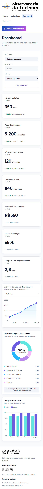
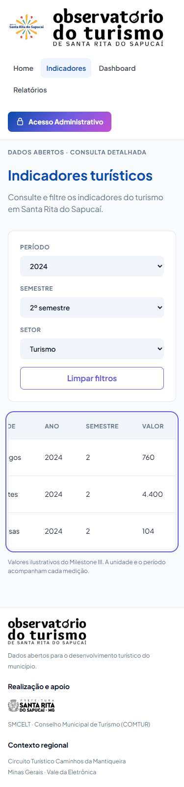

# Evidências do PR #196: responsividade das páginas públicas

Revisão da #190 com `VITE_USE_MOCK=true` e `npm run dev`, no Chrome. As capturas usam larguras de 375, 768 e 1280 px, altura de viewport de 900 px e página inteira.

Referências: [projeto Stitch](https://stitch.withgoogle.com/projects/10242954063342123145) e [mapeamento das telas e marcas](../pr-48/README.md). A revisão preserva os componentes, o tema e a identidade visual existentes.

## Ajustes pontuais

- Em até 640 px, o título e o seletor da série histórica ficam empilhados. Em 375 px, o texto deixa de disputar espaço com o seletor, que ocupa a largura disponível.
- A tabela de Indicadores recebe foco pelo teclado, nome acessível e contorno de foco. As setas permitem rolar até as últimas colunas sem deslocar a página inteira.

## Conferência

| Página | 375 px | 768 px | 1280 px |
|---|---|---|---|
| Home | Sem transbordamento | Sem transbordamento | Sem transbordamento |
| Indicadores | Tabela com rolagem interna | Sem transbordamento | Sem transbordamento |
| Dashboard | Seletor abaixo do título | Sem transbordamento | Sem transbordamento |
| Relatórios | Sem transbordamento | Sem transbordamento | Sem transbordamento |

Nas 12 combinações, a largura total da página correspondeu à largura da viewport e não houve erros de JavaScript. Em 375 px, a tabela tem 341 px disponíveis e 686 px de conteúdo: a rolagem fica dentro da tabela.

Em Indicadores e Dashboard, foram conferidos ano, semestre e setor, alteração da URL, persistência ao recarregar e limpeza dos filtros nas três larguras. O setor foi selecionado pelo teclado. Na tabela, foram conferidos foco e rolagem com a seta para a direita; no gráfico, troca do indicador pelo seletor.

Relatórios foi conferido no estado atual, com a mensagem “Em breve”. A implementação da página pertence à #187 e exigirá nova conferência quando integrada.

Validação do frontend: `npm test` (22 arquivos, 184 testes), `npm run lint` e `npm run build` aprovados. O build emite o aviso de bundle acima de 500 kB.

## Capturas

| Página | Celular | Tablet | Desktop |
|---|---|---|---|
| Home | [375 px](home-375.png) | [768 px](home-768.png) | [1280 px](home-1280.png) |
| Indicadores | [375 px](indicadores-375.png) | [768 px](indicadores-768.png) | [1280 px](indicadores-1280.png) |
| Dashboard | [375 px](dashboard-375.png) | [768 px](dashboard-768.png) | [1280 px](dashboard-1280.png) |
| Relatórios | [375 px](relatorios-375.png) | [768 px](relatorios-768.png) | [1280 px](relatorios-1280.png) |

### Série histórica no celular

Antes:

Depois:

### Tabela com foco e rolagem pelo teclado

Captura após filtrar Turismo em 2024/2 e rolar até a coluna Valor:

