# Evidências do PR #197: ajuste final da identidade visual (#176)

Comparação de cada tela com a Proposta (páginas 6 e 7: identidade visual e
logotipos institucionais). Capturas a 1280 px com o front em modo mock
(`VITE_USE_MOCK=true`); nas telas do painel, a sessão foi simulada com o
usuário Administrador. Relatórios também tem a captura a 390 px para mostrar o
rodapé no celular.

## O que foi conferido

- **Gradiente só nos destaques:** capa da Home, painel lateral do Login, botões
  primários ("Acesso Administrativo", "Entrar") e o emblema e avatar do painel.
  O restante usa fundo claro, como pede a Proposta.
- **Paleta:** gráficos com a paleta de apoio (ciano, roxo, azul-céu, lilás).
- **Tipografia:** Plus Jakarta Sans em todas as telas. A Inter que sobrava em
  `index.css` nunca chegava a aparecer e foi removida.
- **Espaçamentos:** o Dashboard usava largura de 1200 px e ficava desalinhado
  das outras páginas; agora segue os 1280 px de `.page`. Dashboard e Relatórios
  ganharam o mesmo título das Indicadores.
- **Logos:** o rodapé mostra os três níveis da página 7 — Observatório
  (nível 1), Prefeitura, SMCELT e COMTUR (nível 2), Caminhos da Mantiqueira e
  Minas Gerais (nível 3). Antes só a Prefeitura aparecia.
- **Cores do tema:** nenhuma cor escrita direto fora de `frontend/src/theme/`.
  Transparências usam `color-mix()` sobre os tokens.

## O que muda nas capturas

Boa parte da issue foi trocar cores escritas direto por tokens do tema, sem
mudar o valor. Por isso várias telas ficam iguais nos prints. As diferenças
visíveis são:

- **Home, Indicadores, Dashboard e Relatórios:** rodapé com as logos dos
  níveis 2 e 3 (antes só a Prefeitura).
- **Dashboard:** conteúdo alinhado às outras páginas e título em azul.
- **Relatórios:** cabeçalho com eyebrow, título e subtítulo.
- **Login:** fundo dos campos um tom mais azulado (`#EFF4FF` → token
  `--color-primary-soft`, `#E6EEFB`).
- **Telas do painel:** idênticas, já seguiam a Proposta.

## Antes e depois

| Tela | Antes | Depois |
| --- | --- | --- |
| Home | 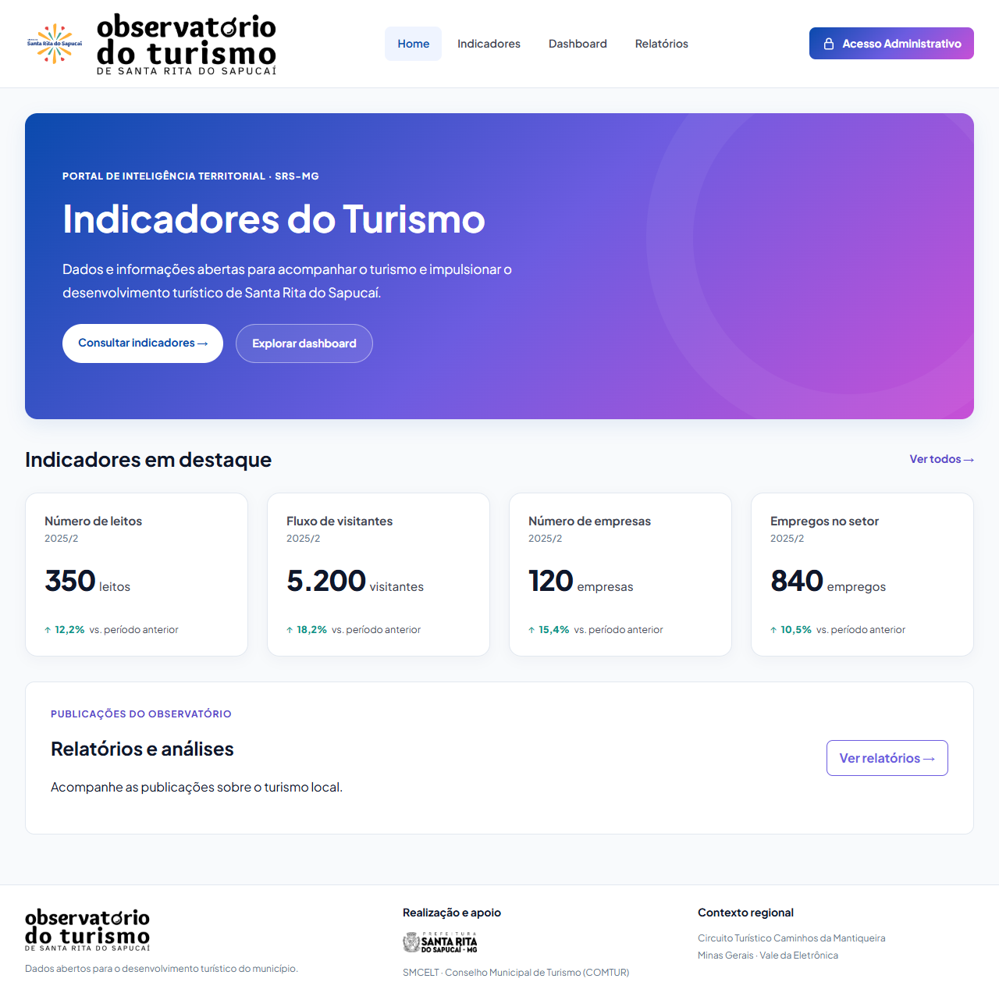 | 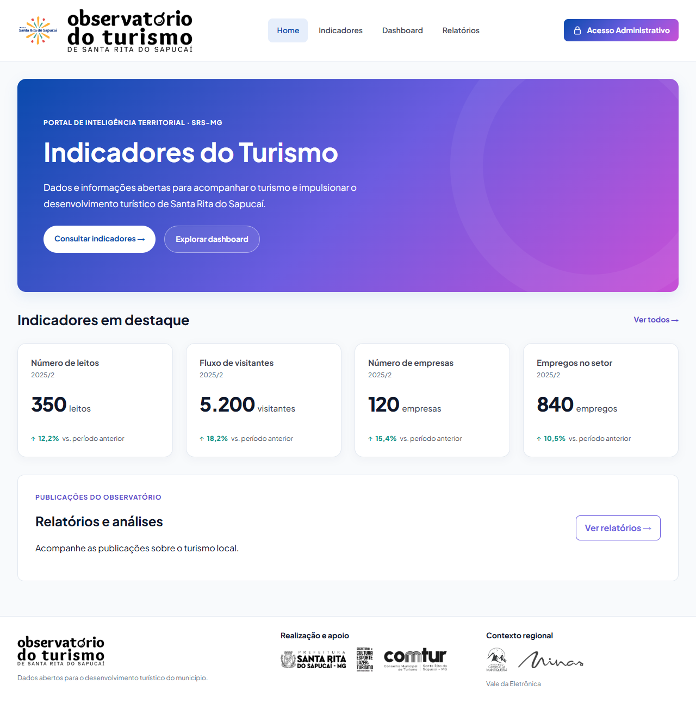 |
| Indicadores | 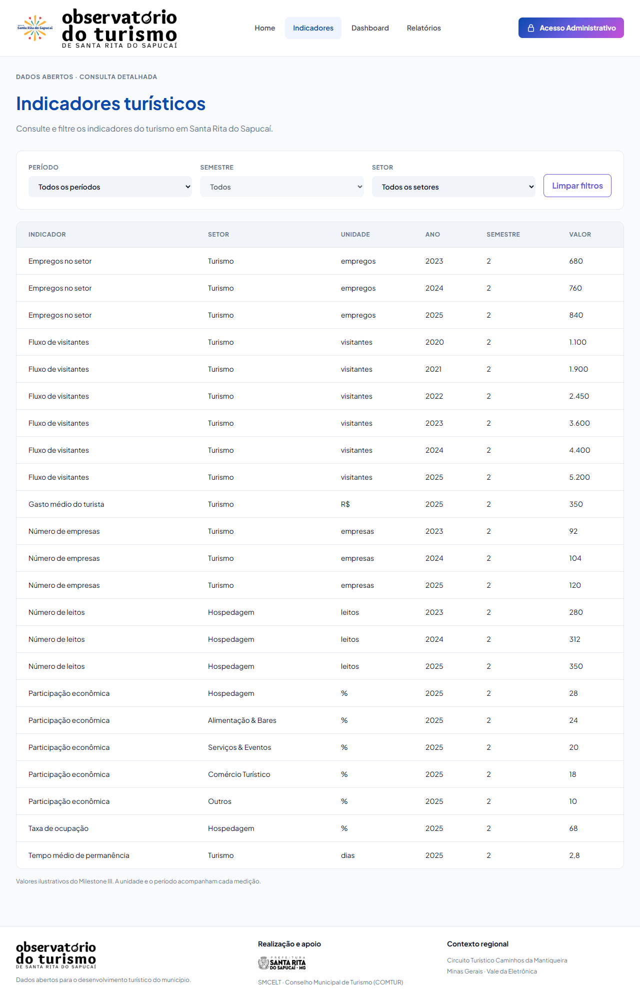 | 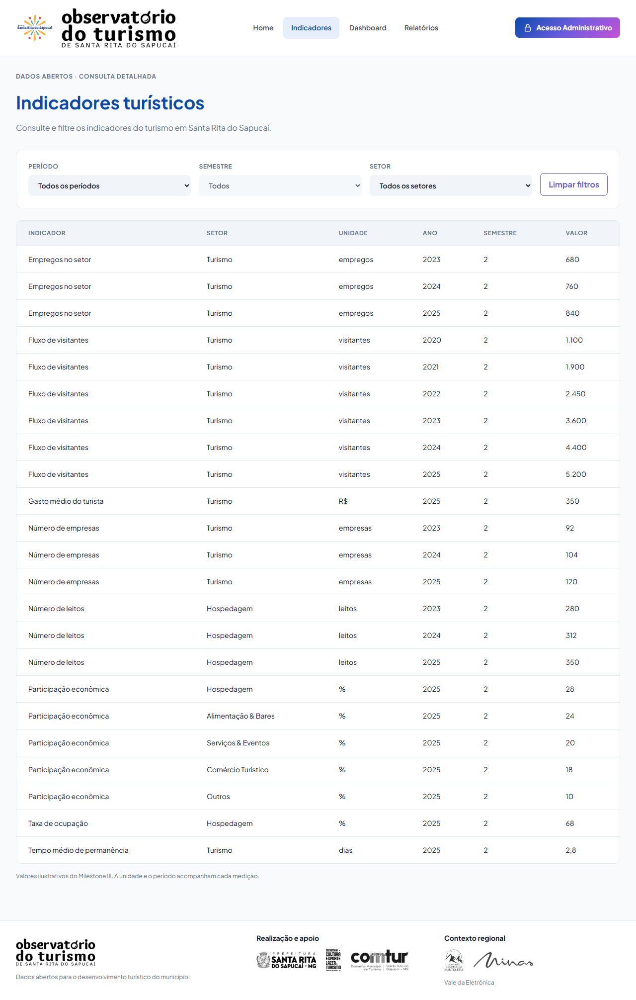 |
| Dashboard | 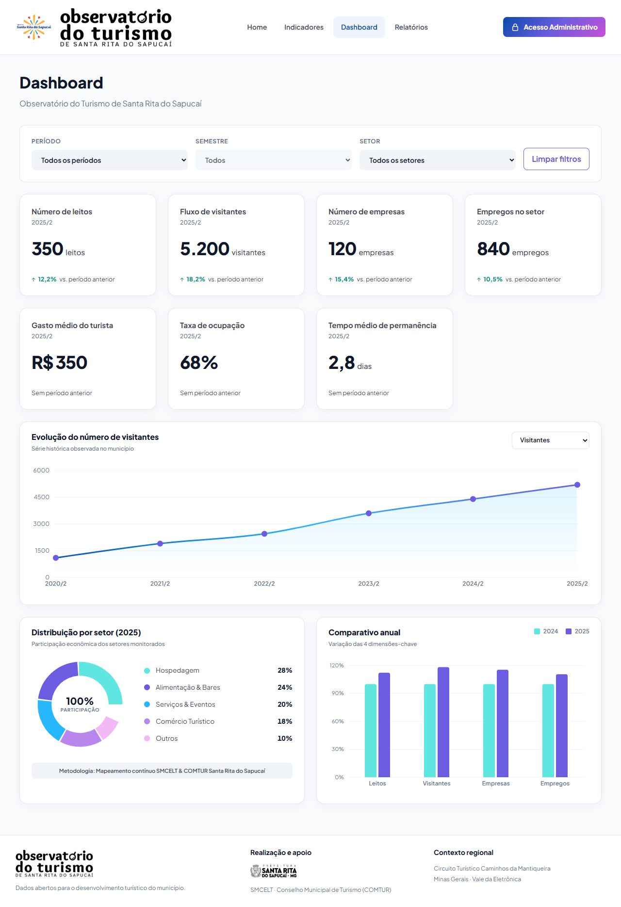 | 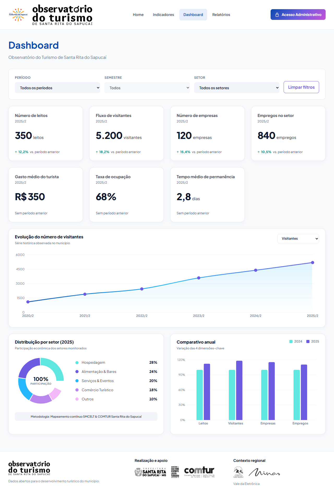 |
| Relatórios | 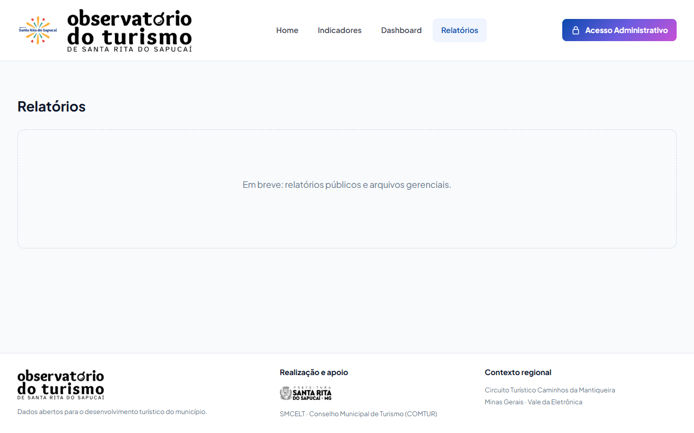 | 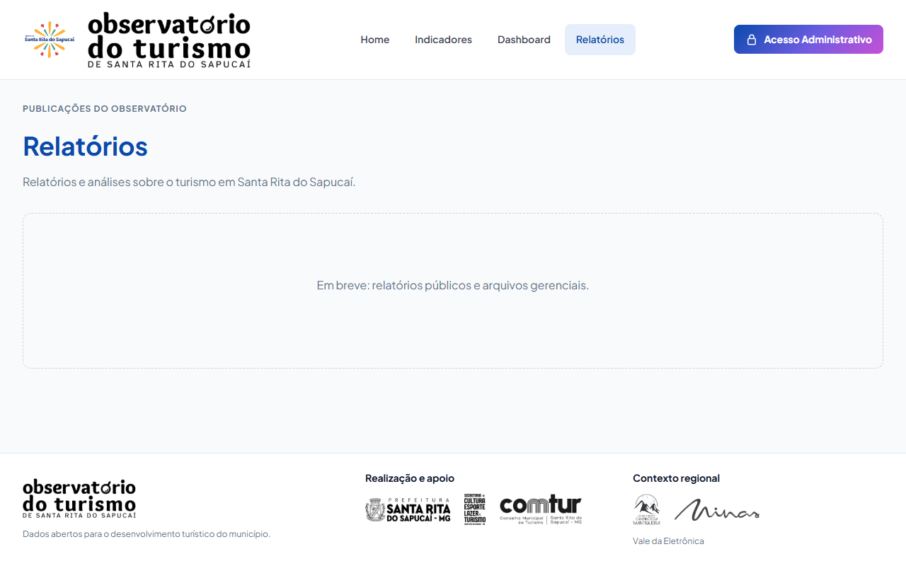 |
| Relatórios (celular) | 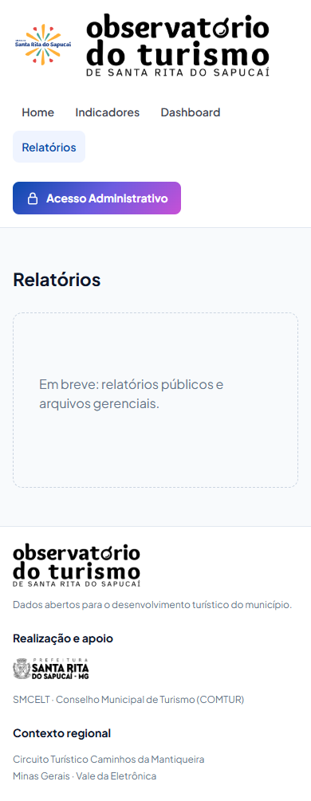 |  |
| Login |  | 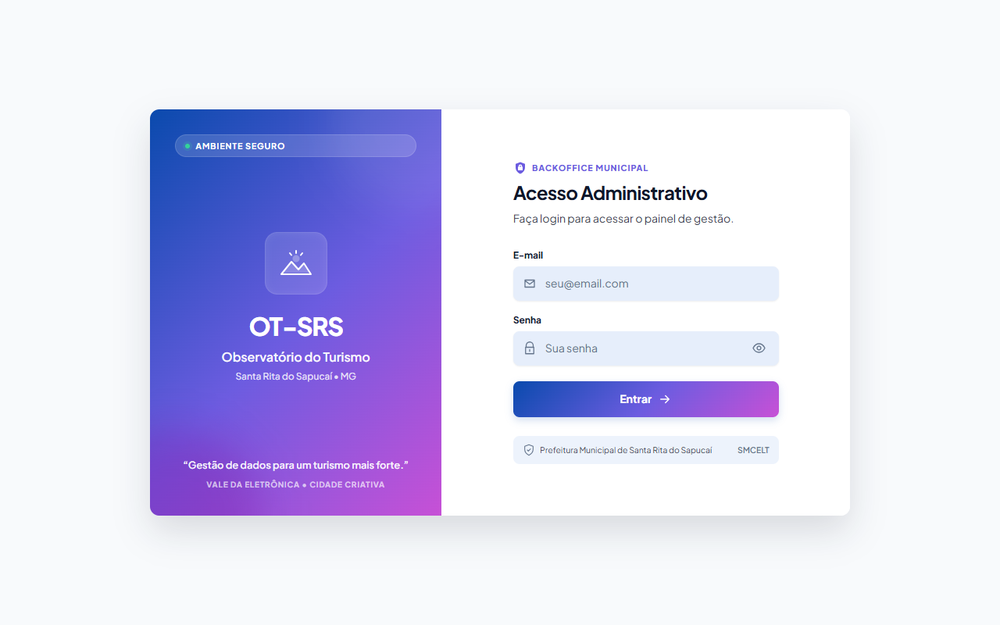 |
| Painel de gestão | 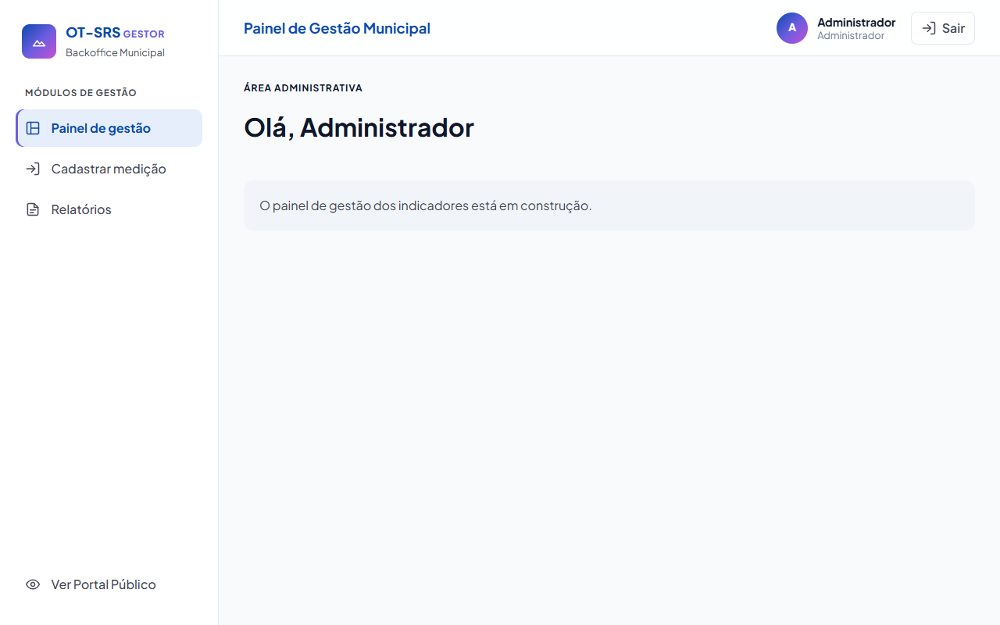 |  |
| Cadastrar medição |  | 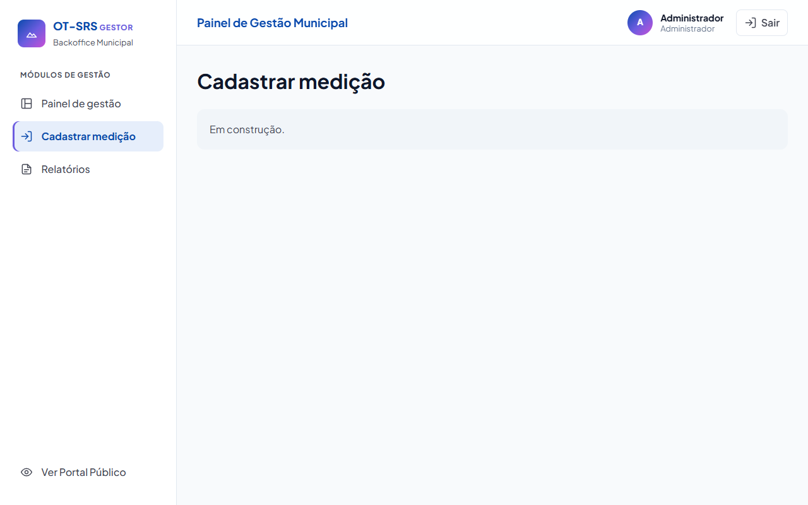 |
| Relatórios (painel) |  | 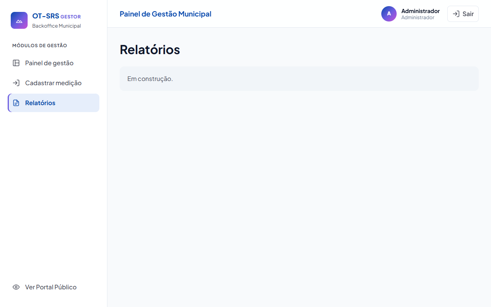 |

As três telas do painel ainda são as provisórias do layout: as telas 6, 7 e 8
(#180, #181, #182) não tinham entrado no `develop` quando estas capturas foram
feitas.
