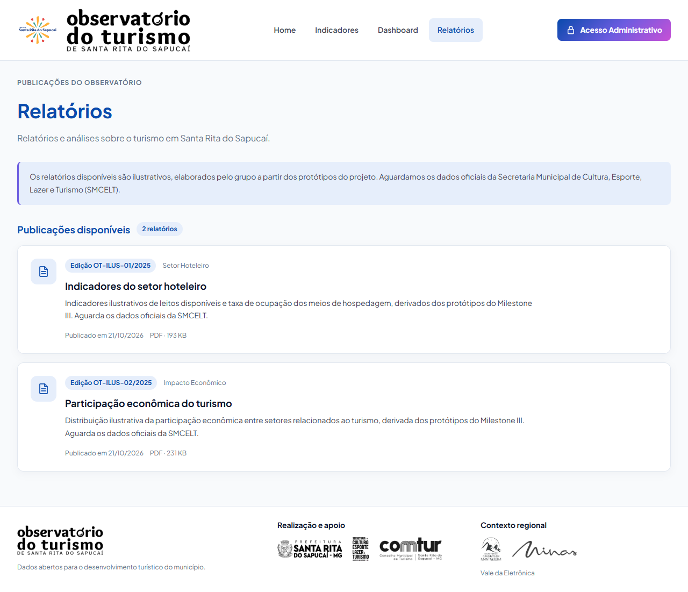

# Evidências do PR #203: página pública de relatórios

Entrega da #187. A página `/relatorios` usa `getRelatorios()` da #186 para exibir as publicações disponíveis e os estados de carregamento, vazio e erro.

## Referências e escopo

- [Stitch — Observatório do Turismo de Santa Rita](https://stitch.withgoogle.com/projects/10242954063342123145), tela `3a2ad5c1ffb845198df3d05b7a3a6719` (“Relatórios do Observatório — Biblioteca Pública”).
- Cards de “Relatórios recentes” da Home do Stitch, com edição, título e descrição.
- Tema institucional existente: Plus Jakarta Sans, cores de `frontend/src/theme/`, superfícies claras, cards com borda e ícone de documento.

O cabeçalho público, a navegação e o rodapé continuam sendo os componentes compartilhados do projeto. A página apresenta título, edição, categoria, descrição, publicação em `dd/mm/aaaa` e tamanho em KB ou MB. A data usa UTC na formatação para preservar o dia informado pela API. Quando o tamanho é nulo, mostra “Tamanho não informado”.

O aviso informa que os relatórios são ilustrativos e aguardam os dados oficiais da SMCELT. As edições de 2025 e a data de publicação em 2026 são mantidas conforme a carga.

Filtros ficam na #188 e download na #189. A página preserva a ordem recebida do serviço, inclusive para publicações da mesma data; não aplica ordenação adicional. O desempate por ID proposto na API (#202) deve ser respeitado pelo serviço e seu mock. Não foram acrescentados busca, paginação, contadores de downloads ou ações sem implementação do protótipo.

## Conferência visual

Chrome, viewport com altura de 900 px e capturas da página inteira. As publicações foram capturadas com `VITE_USE_MOCK=true` e os dois relatórios ilustrativos atuais.

| Largura | Largura total da página | Conteúdo dos cards | Resultado |
|---|---|---|---|
| 375 px | 375 px | Sem transbordamento | Ícone e conteúdo empilhados |
| 768 px | 768 px | Sem transbordamento | Ícone ao lado do conteúdo |
| 1280 px | 1280 px | Sem transbordamento | Cards alinhados ao cabeçalho |

Sem imagens quebradas ou erros de JavaScript nas três larguras. Os estados alternativos foram conferidos em uma instância com mock desligado e respostas HTTP controladas pelo navegador: lista vazia, `503` com mensagem em português e requisição pendente. Essas capturas não representam uma validação com o backend real; a rota pública pertence à #153.

## Testes

Executado em `frontend/`:

```bash
npm test -- --maxWorkers=2
npm run lint
npm run build
```

- 24 arquivos e 214 testes passaram, incluindo 11 testes novos da página.
- Lint e build aprovados. O build mantém o aviso existente de bundle acima de 500 kB.
- Cards com todos os campos e nome acessível; aviso de dados ilustrativos e contagem de publicações.
- Data sem deslocamento de fuso horário, KB, MB, limite de 1024 KB, tamanho zero e nulo.
- Carregamento, vazio, erro e preservação da ordem da resposta.

## Capturas

| Estado | Captura |
|---|---|
| Publicações em 375 px | [Celular](relatorios-375.png) |
| Publicações em 768 px | [Tablet](relatorios-768.png) |
| Publicações em 1280 px | [Desktop](relatorios-1280.png) |
| Carregamento | [Requisição pendente](relatorios-carregando.png) |
| Vazio | [Nenhum relatório publicado](relatorios-vazio.png) |
| Erro | [Falha na consulta](relatorios-erro.png) |




