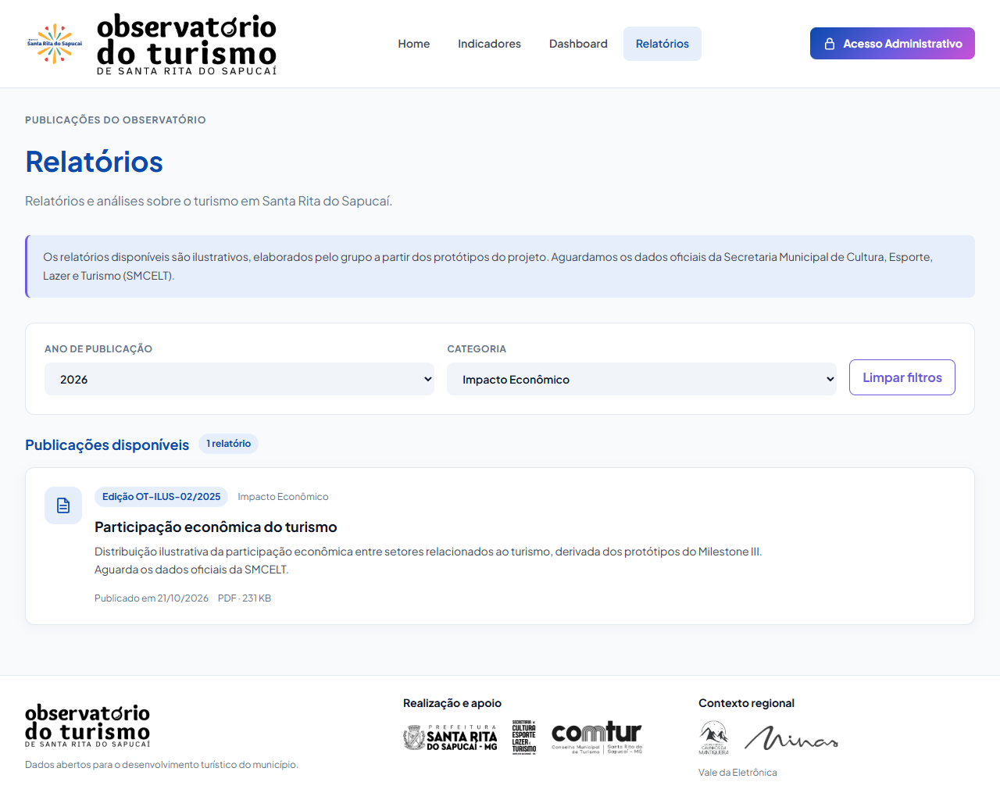

# Evidências do PR #207: filtros de relatórios

Entrega da #188, a partir da `develop` com a página pública (#203) e a API de relatórios (#202) integradas. Reutiliza o painel de filtros existente, com os mesmos estilos, tema e disposição responsiva das outras páginas.

Referências: [Stitch](https://stitch.withgoogle.com/projects/10242954063342123145), tela `3a2ad5c1ffb845198df3d05b7a3a6719`, e [página entregue na #187](../pr-203/README.md).

## Comportamento

- Ano de publicação e categoria ficam em `useSearchParams`, com o endereço preservado ao recarregar ou navegar pelo histórico.
- Anos obtidos de `data_publicacao` dos relatórios públicos, em ordem decrescente. As opções vêm do catálogo completo e não desaparecem quando um filtro retorna vazio.
- As quatro categorias do contrato ficam em `config/relatorios.js`, compartilhadas entre página e mock. Não são usados períodos nem setores dos indicadores para montar os filtros de relatórios.
- “Limpar filtros” remove somente `ano` e `categoria`, preservando os demais parâmetros.
- Um ano informado diretamente na URL, válido mas sem publicações, permanece selecionado e resulta em lista vazia. O painel não substitui silenciosamente a busca por todos os relatórios.
- O catálogo sem filtros é carregado uma vez por montagem. Alterar ano ou categoria consulta `getRelatorios({ ano, categoria })`; limpar restaura o catálogo carregado. Respostas antigas são ignoradas ao mudar a consulta.

Exemplo conferido:

```text
/relatorios?ano=2026&categoria=Impacto+Econ%C3%B4mico
```

As edições dos documentos são de 2025, mas a publicação é de 21/10/2026. Por isso 2026 é a opção da carga atual; `/relatorios?ano=2025` exibe o estado vazio.

## Reaproveitamento e revisão

`FiltrosPainel` aceita `opcoes` com `campo`, `rotulo`, `todos` e `valores` (`valor` e `nome`), além de `statusOpcoes`. Sem essas propriedades, mantém a carga de períodos e setores, os três filtros e a correção da URL já usados por Indicadores e Dashboard.

O mock agora desempata publicações da mesma data pelo ID decrescente, conforme o contrato integrado na #202. A página também remove o anúncio `aria-live` redundante apontado na revisão da #203 e mantém os papéis acessíveis dos estados. Download permanece na #189.

## Validação

Em `frontend/`:

```bash
npm test -- --maxWorkers=2
npm run lint
npm run build
```

- 26 arquivos e 234 testes passaram, incluindo 9 testes novos dos filtros de relatórios.
- Testes existentes de filtros, Indicadores e Dashboard passaram sem mudar suas expectativas.
- Testes novos: anos de publicação, categorias, URL, consulta filtrada, recarregamento, limpeza, vazio, histórico, resposta antiga e recuperação após erro.
- Lint e build aprovados. O build mantém o aviso existente de bundle acima de 500 kB.
- Chrome em 375, 768 e 1280 px, com altura de viewport de 900 px: largura total igual à viewport, sem transbordamento horizontal ou erros de JavaScript.
- Seleções mantidas após recarregar nas três larguras; filtro sem resultado e limpeza conferidos; parâmetros alheios aos filtros preservados.
- Indicadores e Dashboard conferidos com `ano=2024&semestre=2&setor=6` e suas seleções existentes.

Os prints usam `VITE_USE_MOCK=true`. Também foram verificadas as chamadas `/api/relatorios` e `/api/relatorios?ano=2026&categoria=Impacto+Econ%C3%B4mico` com mock desligado e respostas controladas no navegador, no formato do contrato. O container local ainda responde `404` nessa rota, pois serve uma versão anterior; não foi feita integração ponta a ponta com o backend atual nesta conferência.

## Capturas

| Situação | Captura |
|---|---|
| Todos os relatórios | [1280 px](relatorios-todos-1280.png) |
| Ano e categoria após recarregar | [375 px](relatorios-filtrados-375.png) · [768 px](relatorios-filtrados-768.png) · [1280 px](relatorios-filtrados-1280.png) |
| Categoria válida sem dados | [Estado vazio](relatorios-vazio-1280.png) |
| Regressão de Indicadores | [1280 px](regressao-indicadores-1280.png) |
| Regressão de Dashboard | [1280 px](regressao-dashboard-1280.png) |




